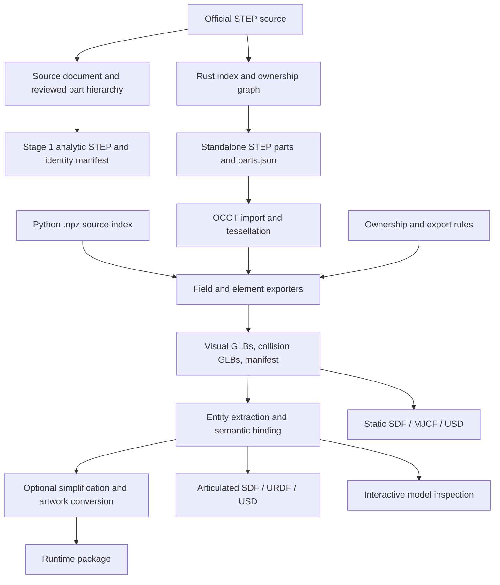

<!-- SPDX-License-Identifier: MIT OR Apache-2.0 -->
<!-- Copyright (c) 2026 hxyulin <hxyulin@proton.me> -->
# Architecture

[Documentation](README.md) · [Exporting](exporting.md) · [Simplification](simplification.md) · [简体中文](zh/architecture.md)

`rm-map-tools` separates source splitting, CAD meshing, and package processing. Rust handles STEP bytes and references. Python uses OCCT to import split parts and produces the assets consumed by viewers and simulators.

## Pipeline

These branches are separate workflows. A format adapter does not run every optimization automatically. See [Exporting](exporting.md) for inputs and [Simplification](simplification.md) for ordering constraints.

The new source-first path publishes [stage-one hierarchical CAD](cad-hierarchy.md).
This checkpoint preserves analytic geometry, source styles, identities and
existing instances before tessellation. Existing runtime export jobs still start
from the original STEP and their own rules. They do not automatically consume
this checkpoint: that adapter must use its identity manifest to resolve the
renamed product/wrapper IDs. Additional exact-sharing passes are separate from
this first baseline release.

## Source processing

The Rust scanner records each STEP entity's ID, type, byte range, and outgoing references. The ownership model identifies products, bodies, assembly occurrences, and styles. The splitter follows each product's references and copies the selected geometry entities verbatim, filtering shared presentation lists to the selected members.

This stage needs no CAD kernel. OCCT imports the resulting parts to check faces, bounds, and colors and to approximate surfaces with triangles. Source preservation and mesh accuracy are separate checks. The [split proof](split-proof.md) records preservation evidence; [STEP internals](step-internals.md) documents the index format, Rust modules, and closure algorithm.

The Rust `.p21idx` sidecar and Python `.npz` source index are different formats. The CLI uses the former; Python geometry exporters use the latter alongside `parts.json` and the split STEP files.

## Shared in-memory CAD document

`python/cad_document.py` joins the exact STEP graph, assembly/ownership model
and lazily imported OCCT XCAF working model. Discovery accepts STEP directly
without an intermediate file, or reuses an existing parser index. Unknown
metadata remains accessible from original entities rather than being reduced to
render colors. Native import enables supported property, material, GD&T,
instance-style, view and product metadata modes in addition to names/colors/layers.
`python/cad_passes.py` adds immutable derived scenes, inspectable sharing plans
and atomic application of exact geometry/presentation-definition sharing. Source
identities, face correspondence, occurrences and style bindings stay separate.
See [the pass infrastructure](cad-optimization-passes.md) for lifetime, source
identity, mutable-model and language boundaries.

`python/cad_optimizer.py` adds a source-backed [optimizer IR](cad-optimizer-ir.md):
packed geometry/appearance recipe DAGs, source-owned topology incidence and body
uses, frame-free analytic prototypes, and exact unit-shape affine instances.
This is an in-memory preparation layer, not a standalone CAD storage format or
a runtime exporter. Source frames, dimensions, paint bindings and ownership stay
independent. Optional exact parameter normalizations are measured rather than
assumed beneficial; default affine factoring preserves source parameterization.

The source exporter reuses this context through `Package(document=...)` and
adds small `cad_source` node extras with source hash, product/body IDs and
occurrence paths. Extras belong to instances and do not enter the mesh-sharing
key. Release recomposition preserves these extras and full occurrence paths.
The simulator adapter retains upstream extras as provenance rather than
interpreting them as new gameplay bindings. The low-level mesh writer and reader can preserve node extras; callers
recomposing older packages must opt into the reader's `include_extras=True`.
This is source provenance, separate from gameplay/semantic IDs. Existing mesh
adapters still reduce materials to effective RGB and may omit empty anchors or
primitive attributes. They are not a general lossless CAD scene transport.

## Asset generation

Field and element exporters apply placement and ownership rules, tessellate visual and collision geometry independently, and write GLBs with manifests and validation reports. Export policies control tolerances and explicit collision exclusions. Copied equipment retains its existing geometry and metadata.

Entity extraction creates separately named assets. Semantic binding adds joint hierarchy, armor, LED, team-color, and layer metadata to GLB node extras and `articulation.json`. Rules can select source triangles, so binding must precede simplification. Texture patches are attached after backing simplification.

Manifests record file hashes and collision methods. Consumers use these declarations to choose and validate collider files. Hash checking detects changed files; it does not establish geometric accuracy. See [export presets](export-presets.md), [semantic export](semantic-export.md), and [mesh simplification](mesh-simplification.md) for the contracts.

## Motion and consumers

The semantic reference package is separate from the active simulator installation. Articulated exporters use its existing motion-node hierarchy to create rigid links and joints. Static adapters bake articulated inputs at rest when explicitly requested.

The documentation viewer renders local models with Three.js and exposes joint coordinates as sliders. The Technology Core keeps six joint frames in the reference; its animated mesh uses a separate preview rig. Match controllers belong to the consuming simulator. See [reference assets](reference-assets.md) and [articulated formats](articulated-formats.md).

## Code map

| Location | Responsibility |
| --- | --- |
| `crates/step21/` | Scanner, index, ownership model, and STEP splitter |
| `crates/rm-map-tools/` | `index`, `inspect`, and `split` CLI |
| `python/export_*.py` | Geometry, semantic, and simulator exporters |
| `python/export_job.py` | JSON job validation and ordered stage execution |
| `python/cad_optimizer.py` | Source-backed recipe DAGs, analytic prototypes and exact affine instance preparation |
| `python/simplify_package.py` | Mesh reduction and deviation checks |
| `python/texture_atlas.py` | Artwork extraction, backing simplification, and texture export |
| `python/preview/` | Source HTML viewer and reusable motion/rig helpers |
| `docs/.vitepress/` | Documentation theme and interactive model viewer |
| `rules/` | Export settings and reviewed source selections |
| `source/` | Download helper and source/reference records |
| `benchmarks/` | Dated measurements and reproduction scripts |

[Performance](performance.md) collects timing and memory measurements. [Geometry audit](geometry-audit.md) records source omissions and corrections.

The optional `python/cad_ir_structure.py` view makes topology incidence explicit,
decodes packed typed operands, and supplies context-scoped stable recipe/rooted
graph hashes. `python/audit_ir_structure.py` checks these against the full source;
see [the IR guide](cad-optimizer-ir.md) for guarantees and remaining trim work.

`python/cad_patch_matching.py` adds finite straight-boundary planar patch metrics
and original-use correspondence. `python/cad_shape_fitting.py` produces measured
primitive proposals; `python/audit_patch_fits.py` runs the read-only source audit.
See [finite patches and fits](cad-patch-fitting.md) for exact versus approximate
acceptance and the remaining curved-trim/native deviation work.

`python/cad_vector_ir.py` adds finite formulas, exact-decimal spline fallbacks,
source-anchored polygon templates and ruled-surface tessellation infrastructure.
`python/build_vector_selection.py` applies the automatic policy;
`python/export_vector_selection.py` exports a portable selection at a total
curve error budget. See [vector IR and precision](cad-vector-ir.md).

`python/cad_component.py` verifies source/native geometry identity and captures
complete plane/extrusion body topology. `cad_component_mesh.py` meshes the shared
boundary network; `cad_vector_cache.py` pools verified rigid curve prototypes and
quality-keyed tessellations. `build_vector_component.py` exports a complete review
component and checks native supports; see [component export](cad-vector-component.md).

## Hierarchical optimization and LOD planning

[Hierarchical optimization and LOD](cad-lod-optimization.md) defines the source-first
pass sequence, geometry/ownership graph separation, content-addressed variants
and mixed-detail interface contract. `python/cad_lod_policy.py` implements the
pure planning boundary: inherited per-node quality, protected subtrees, cumulative
error budgets, scale-aware requests, shared-boundary limits and cache identity.
It does not yet drive native meshing, runtime selection or a new package format.

`python/cad_collision_roles.py` provides source/hierarchy-pinned visual-only
marking bindings. The component exporter and optional hierarchy planner consume
these roles; embedded paint keeps separately owned collision backing coverage.
See [road LOD and collision-role evidence](../benchmarks/2026-10-17-road-lod/README.md).

`python/cad_patch_instances.py` factors bounded finite faces into affine quad/triangle
uses, retaining original topology, source appearance targets and marking roles.
`cad_patch_storage.py` stores numeric tables with exact per-use round trips and
optional edge-vector interning. `GlbWriter.add_indexed_instance()` shares complete
indexed payloads across material variants. See [finite patch instancing](cad-patch-instancing.md)
for scope, compression measurements and native/runtime promotion gates.

`cad_wall_fill.py` owns explicit native additive wall fills with source/panel
history and bounded volume checks; `apply_wall_fills.py` applies pinned component
policies and validates derived STEP/GLB exports. See [wall filling](cad-wall-fill.md).
